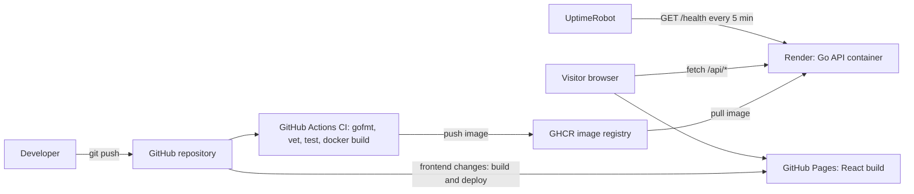

# Personal Profile

My personal website, built as a small end-to-end DevOps project: Go backend, static frontend, Docker, and automated CI/CD.

**Live site:** https://neginsal.github.io/personal-profile/

## Architecture

## Tech stack

| Layer | Tools |
|---|---|
| Backend | Go (standard library only) |
| Frontend | React, TypeScript, Vite (seasonal theme, canvas particles) |
| Container | Docker, multi-stage build, non-root user |
| CI/CD | GitHub Actions |
| Registry | GitHub Container Registry (GHCR) |
| Hosting | GitHub Pages (frontend), Render free tier (backend) |
| Monitoring | UptimeRobot on `/health` |

## API

| Endpoint | Description |
|---|---|
| `GET /health` | Health check |
| `GET /api/profile` | Profile data |
| `GET /api/projects` | Project list |
